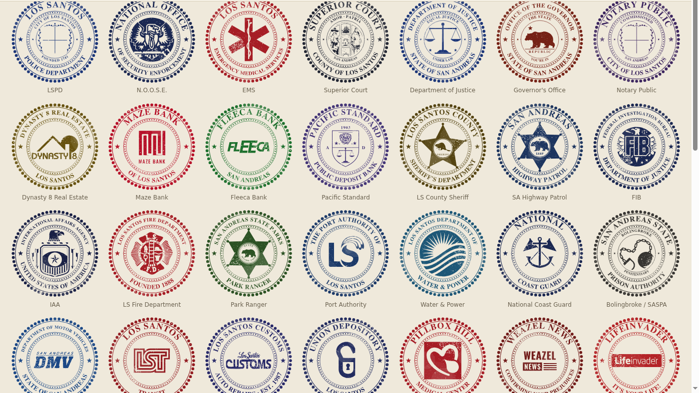
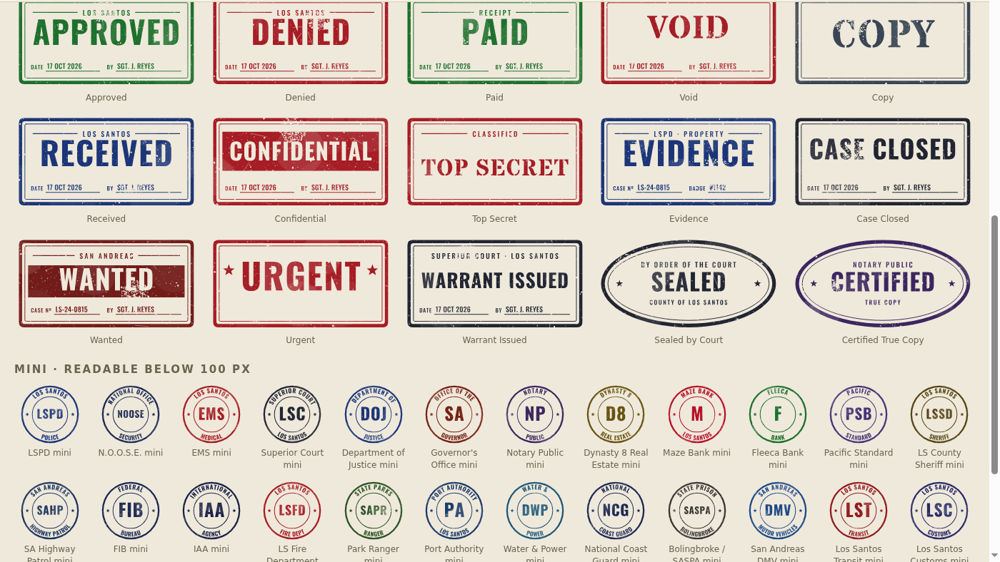
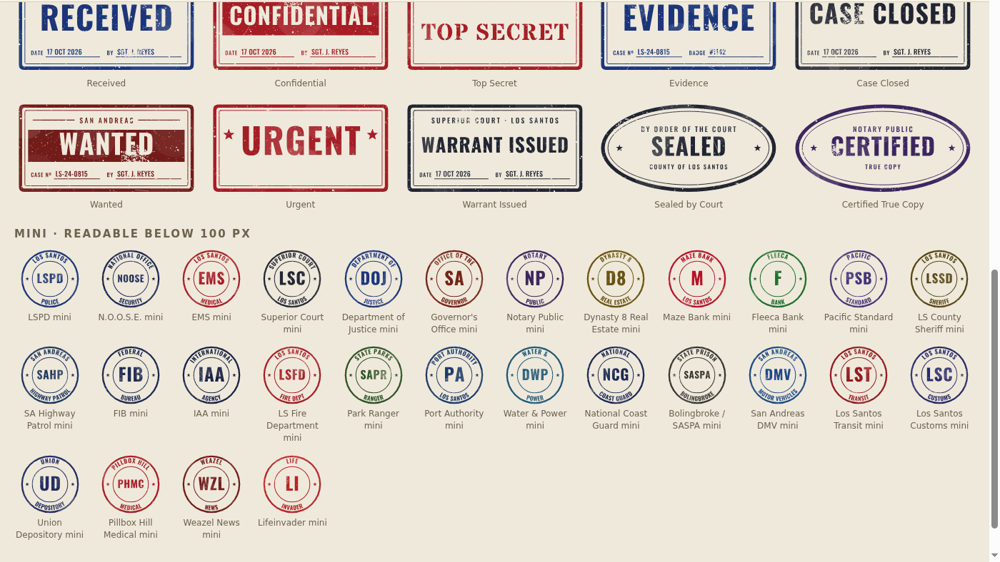
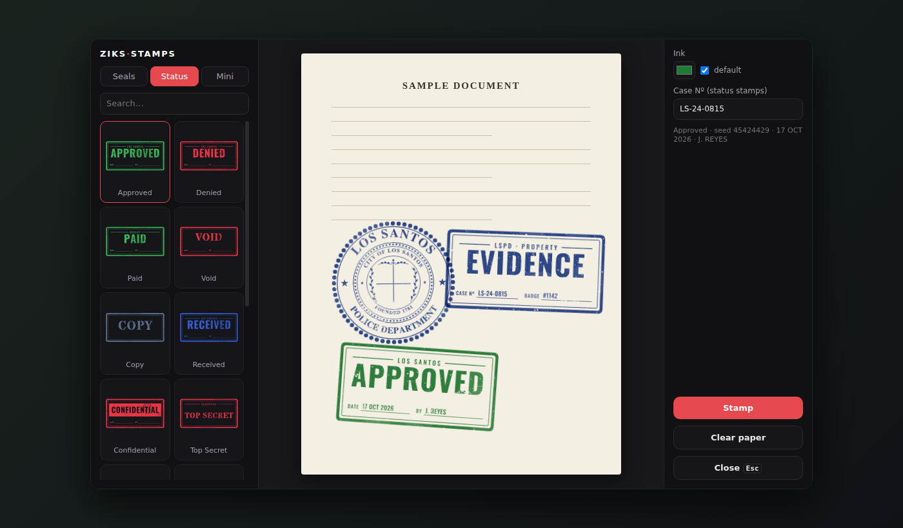

# GTA V Lore Stamps

Free lore-friendly rubber stamps and seals for Grand Theft Auto V roleplay documents:
- **28 department and business seals**
- **15 status stamps** with live date and officer fields
- **28 mini stamps** that stay readable below 100 px
- **a ready FiveM resource** (`ziks-stamps`)

Everything is pure SVG: recolour it with one CSS variable and give it random rubber-stamp wear.

**[Live demo](https://fivem.ushpuras.dev/stamps)**: recolour, re-stamp with random wear, and type into the date, officer, case and badge fields.



## Contents

### Seals: `svg/`
| # | Stamp | # | Stamp |
|---|---|---|---|
| 00 | LSPD (City of Los Santos seal) | 14 | IAA |
| 01 | N.O.O.S.E. | 15 | LS Fire Department |
| 02 | Los Santos EMS | 16 | SA Park Ranger |
| 03 | Superior Court (County seal) | 17 | Port Authority of Los Santos |
| 04 | Department of Justice | 18 | LS Department of Water & Power |
| 05 | Office of the Governor | 19 | National Coast Guard |
| 06 | Notary Public | 20 | Bolingbroke / SA State Prison Authority |
| 07 | Dynasty 8 Real Estate | 21 | San Andreas DMV |
| 08 | Maze Bank | 22 | Los Santos Transit |
| 09 | Fleeca Bank | 23 | Los Santos Customs |
| 10 | Pacific Standard | 24 | Union Depository |
| 11 | LS County Sheriff | 25 | Pillbox Hill Medical Center |
| 12 | SA Highway Patrol | 26 | Weazel News |
| 13 | FIB | 27 | Lifeinvader |

The emblems are taken from the actual in-game seals and logos. The mottos are lore too:
"Obey & Survive", "Amor Patria", "The State You're In" and "Confirming Your Prejudices".

### Status stamps: `svg/status/`
APPROVED · DENIED · PAID · VOID · COPY · RECEIVED · CONFIDENTIAL · TOP SECRET · EVIDENCE · CASE CLOSED ·
WANTED · URGENT · WARRANT ISSUED · SEALED (by order of the court) · CERTIFIED (true copy)

Most of them have blank **DATE / BY / CASE Nº / BADGE** lines that JS fills in.



### Mini stamps: `svg/mini/`
Every seal also comes as a simple ring with a big abbreviation (LSPD, FIB, DMV…), for use where the detailed artwork would turn into a blob.



`stamps.json` lists every stamp with its file, title, default ink and fields.
`png/` has transparent PNGs of everything: seals and status stamps both clean and worn, and the minis.

## Features
- **Pure vector.** No embedded images and no fonts are needed, because all lettering is converted to paths.
- **One-colour ink.** Change it with `--stamp-ink` or by editing the file.
- **Built-in wear.** Each file has a fixed default rubber-stamp wear, which you can switch off with `--stamp-wear: none`.
- **Random wear and tilt.** `stamp-wear.js` gives a new pattern on every stamp. Store the seed and the document looks identical when it is reopened.
- **Live fields.** Date, officer, case number and badge are drawn as vector text, so no font is needed. Latin, Cyrillic and digits are supported.
- **Many copies per page.** The same stamp can appear many times on one page; each copy gets its own ids.
- **FiveM resource.** Server export, framework auto-detect (qbx / qb / esx / standalone) and a `/stamps` gallery.

## Quick start (web or NUI)

```html
<script src="stamp-wear.js"></script>
<div id="slot" style="width:200px"></div>
<script>
  renderStamp(document.getElementById('slot'), {
    url: 'svg/status/approved.svg',
    seed: 1838201,                       // omit for random; store it to reproduce
    ink: '#1e7a34',                      // optional
    fields: { date: '17 OCT 2026', by: 'SGT. J. REYES' },
    rotate: true,                        // random tilt of up to ±8°
  }).then(({ svg, seed }) => console.log('stamped with seed', seed));
</script>
```

If you want a fixed stamp with no JS at all, use ``.

## Changing the colour


```css
.gta-stamp { --stamp-ink: #b11f2b; }   /* inline SVGs only */
```
Without CSS, edit the hex code in `color="#……"` and `var(--stamp-ink, #……)` in the file, or set one fill colour in Inkscape or Illustrator.

## Wear


Each stamp has an SVG `<mask>` laid over its ink. White in the mask keeps the ink and black removes it. The mask contains:
- about 1,350 dots and 60 irregular blots, like paper grain and spots where the ink skipped;
- a "dry" area with denser gaps;
- 6 thin scratches;
- 6 very faint patches that lighten the ink slightly, like uneven pressure.

It uses no filters, so it renders the same in every browser and in CEF.

## JS API (`stamp-wear.js`)

| Function | Description |
|---|---|
| `renderStamp(container, { url \| name+base, seed, ink, fields, rotate, density, wear })` | Fetch the SVG, inline it, then apply ink, wear and fields. Returns `Promise<{ svg, seed }>`. Falls back to `` if the fetch fails. |
| `stampWear(svg, { seed, density, dry, scratches, rotate })` | New wear on an inline SVG. Returns the seed it used. |
| `stampFields(svg, { date, by, case, badge })` | Fill the blank lines on status stamps. Long text shrinks to fit. |
| `inlineStamp(img)` | Swap an `` for inline SVG. |

Wear options:
- `density`: 0.3 is almost clean, 1 is the default, 2 is very worn.
- `dry`: strength of the faded area.
- `scratches`: number of thin scratches (default 6).
- `rotate`: `true` for a random tilt, or a number of degrees.

## FiveM resource (`fivem/ziks-stamps`)



```lua
-- server: create stamp data; date, officer and badge are filled from the framework
local stamp = exports['ziks-stamps']:CreateStamp(source, 'evidence', { fields = { case = 'LS-24-0815' } })
-- save `stamp` with your document, then send it to your NUI:
```
```js
renderStamp(slot, { url: 'https://cfx-nui-ziks-stamps/html/' + stamp.file,
                    seed: stamp.seed, ink: stamp.ink, fields: stamp.fields });
```

Install: copy `fivem/ziks-stamps` into `resources`, then add `ensure ziks-stamps` to `server.cfg`. In game, `/stamps` opens the gallery.
There is also a ready zip on the [Releases](https://github.com/ziks29/gta5-lore-stamps/releases) page.
Full docs: [fivem/ziks-stamps/README.md](fivem/ziks-stamps/README.md).

## License

[MIT](LICENSE) © 2026 [ziks](https://github.com/ziks29).

You can use the stamps in **free and paid** scripts, servers and assets, and you can modify and resell them as part of your work.
The one condition is that you keep the copyright and license notice: it is in `LICENSE`, inside every SVG and at the top of `stamp-wear.js`.

A visible credit is appreciated:
`Stamps: GTA V Lore Stamps by ziks — github.com/ziks29/gta5-lore-stamps`

Grand Theft Auto names and logos belong to Rockstar Games / Take-Two Interactive, and the MIT license does not cover them.
See [NOTICE.md](NOTICE.md). This is an unofficial fan project.
