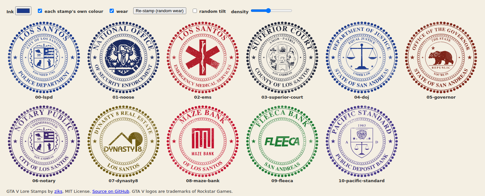
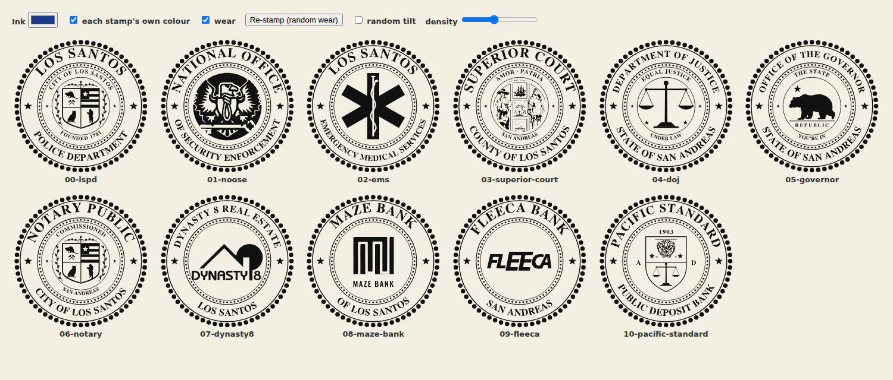
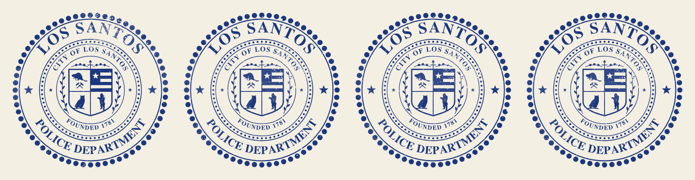

# GTA V Lore Stamps

11 lore-friendly rubber stamps and seals for Grand Theft Auto V roleplay documents.
They are pure SVG, you can recolour them, and each one has wear that can be randomised.
Made for FiveM / RedM NUI, MDT and document scripts, and for web panels.

**[Live demo](https://ziks29.github.io/gta5-lore-stamps/)**: change the ink colour, switch the wear off, or re-stamp with random wear.



## Stamps

| File | Stamp | Centre emblem |
|---|---|---|
| `00-lspd.svg` | Los Santos Police Department | Seal of the City of Los Santos (beaver, flag, owl, Bigfoot) |
| `01-noose.svg` | N.O.O.S.E. | Eagle with key from the in-game seal |
| `02-ems.svg` | Los Santos EMS | Star of Life |
| `03-superior-court.svg` | Superior Court, County of Los Santos | County seal, "Amor · Patria" |
| `04-doj.svg` | Department of Justice, State of San Andreas | Scales of justice |
| `05-governor.svg` | Office of the Governor | San Andreas Republic bear, "The State You're In" |
| `06-notary.svg` | Notary Public | City of Los Santos shield |
| `07-dynasty8.svg` | Dynasty 8 Real Estate | Dynasty 8 logo |
| `08-maze-bank.svg` | Maze Bank of Los Santos | Maze Bank mark |
| `09-fleeca.svg` | Fleeca Bank | Fleeca wordmark |
| `10-pacific-standard.svg` | Pacific Standard Public Deposit Bank | 1903 shield with lion and scales |

## Features
- **Pure vector.** There are no embedded images and no fonts, because all lettering is converted to paths. Each file is 800×800 with a transparent background and is 45–230 KB.
- **Lore-based.** The emblems come from the actual in-game seals and logos, and the mottos come from the game: "Obey & Survive", "Amor Patria" and "The State You're In".
- **One-colour ink.** You can change the ink colour by editing the file or with one CSS variable.
- **Built-in wear.** Each file has a fixed default rubber-stamp wear, and you can switch it off.
- **Random wear.** `stamp-wear.js` gives a new pattern on every stamp. A seed number reproduces the same pattern later.
- **Random tilt.** The script can also tilt the stamp by up to ±8°, like a hand-pressed stamp.
- **Many copies per page.** The same stamp can appear many times on one page; the script keeps each copy separate.
- **PNG versions.** `png/` has transparent 1200×1200 PNGs of every stamp, clean and worn, for tools that can't use SVG.

## Quick start

```html
<!-- simplest: fixed colour + fixed wear -->

```

To recolour the stamps or randomise the wear, the SVG has to be **inline** in the page:
paste the file contents in, or use `inlineStamp()` as shown below.

## Changing the colour



```css
.gta-stamp { --stamp-ink: #b11f2b; }              /* every stamp red */
.doc-approved .gta-stamp { --stamp-ink: #1e7a34; } /* or per document */
```

Without CSS, open the `.svg` in a text editor and change the hex code in `color="#……"` and `var(--stamp-ink, #……)`.
In Inkscape or Illustrator, select all and set one fill colour.

Default inks:

| Stamp | Ink |
|---|---|
| LSPD, DOJ | `#1c3a8c` |
| NOOSE | `#1b2a5e` |
| EMS | `#b11f2b` |
| Court | `#23283a` |
| Governor | `#7d2418` |
| Notary | `#40286e` |
| Dynasty 8 | `#6e5a12` |
| Maze | `#c3122f` |
| Fleeca | `#1e7a34` |
| Pacific | `#47398a` |

## Wear



### How it works
Each stamp has an SVG `<mask>` laid over all of its ink. White in the mask keeps the ink and black removes it. The mask contains:
- about 1,350 tiny dots and 60 irregular blots, which look like paper grain and spots where the ink skipped;
- one "dry" area with denser gaps, where the stamp lifted unevenly;
- 6 thin scratches;
- 6 large, very faint patches that lighten the ink slightly, like uneven pressure.

It is all vector shapes, with no filters, so it renders the same in every browser and in CEF.

### Switching the wear off
```css
.gta-stamp { --stamp-wear: none; }
```
In the file itself: remove `mask="url(#…-wear)"` and the `style="mask:…"` on the inner `<g>`.

### Random wear (`stamp-wear.js`)
```html
<script src="stamp-wear.js"></script>
<script>
  // new wear + random tilt on every inline stamp
  document.querySelectorAll('.gta-stamp').forEach(svg => stampWear(svg, { rotate: true }));

  // reproducible: store the seed with the document
  const seed = stampWear(svg);      // random pattern, returns the seed it used
  stampWear(svg, { seed });         // later: exactly the same pattern

  // works with  too: it is converted to inline SVG first
  inlineStamp(document.querySelector('img.stamp')).then(svg => stampWear(svg, { density: 1.3 }));
</script>
```

| Option | Default | Description |
|---|---|---|
| `seed` | random | number or string; the same seed gives the same wear |
| `density` | `1` | `0.3` is almost clean, `2` is very worn |
| `dry` | `1` | strength of the faded patch; its position is random |
| `scratches` | `6` | number of thin scratches |
| `rotate` | off | `true` for a random ±8° tilt, or a number of degrees |

## FiveM NUI example

`fxmanifest.lua`
```lua
ui_page 'html/index.html'
files { 'html/index.html', 'html/stamp-wear.js', 'html/stamps/*.svg' }
```

`client.lua`
```lua
-- stamp a document; save the seed in your DB so the document looks the same when reopened
RegisterCommand('stamp', function(_, args)
    SendNUIMessage({ action = 'stamp', stamp = args[1] or '00-lspd', seed = tonumber(args[2]) })
    SetNuiFocus(true, true)
end)
```

`html/index.html`
```html
<div id="doc"></div>
<script src="stamp-wear.js"></script>
<script>
window.addEventListener('message', async ({ data }) => {
  if (data.action !== 'stamp') return;
  const img = new Image(); img.src = `stamps/${data.stamp}.svg`; img.width = 160;
  document.getElementById('doc').appendChild(img);
  const svg = await inlineStamp(img);
  const seed = stampWear(svg, { seed: data.seed ?? undefined, rotate: true });
  svg.style.cssText += 'position:absolute;right:40px;bottom:40px;mix-blend-mode:multiply;opacity:.9';
  fetch(`https://${GetParentResourceName()}/stamped`, { method: 'POST', body: JSON.stringify({ seed }) });
});
</script>
```

Tip: `mix-blend-mode: multiply` with opacity around 0.9 makes the stamp look printed onto the paper.

## License

[MIT](LICENSE) © 2026 [ziks](https://github.com/ziks29).

You can use these stamps in **free and paid** scripts, servers and assets, and you can modify and resell them as part of your work.
The one condition is that you **keep the copyright and license notice**:
- include the `LICENSE` file, or the notice line, in your resource;
- the notice is also inside each SVG and in `stamp-wear.js`, so leave those comments in place.

A visible credit in your script's README is appreciated:
`Stamps: GTA V Lore Stamps by ziks — github.com/ziks29/gta5-lore-stamps`

Grand Theft Auto logos and brands belong to Rockstar Games / Take-Two Interactive, and the MIT license does not cover them.
See [NOTICE.md](NOTICE.md) for details and third-party credits. This is an unofficial fan project.
