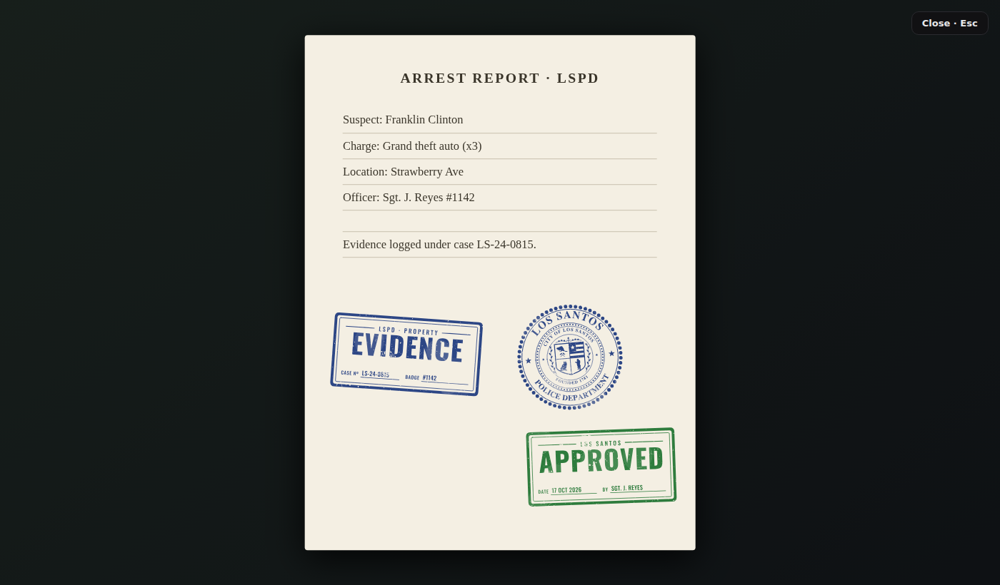

# ziks-stamps (FiveM resource)

A drop-in resource for the GTA V Lore Stamps. With pure Lua exports you can:
stamp a document, save the stamp, and show it on the player's screen.
No NUI code is needed in your own script.

- **Standalone.** It reads name and callsign automatically on **qbx_core**, **qb-core** and **es_extended**; otherwise it uses the FiveM player name.
- **Storage.** Stamps are saved to **oxmysql** when it is running, otherwise to the resource's own **KVP** storage.
- **Date.** The DATE field uses either the real server clock or the player's **in-game clock**.
- **Viewer.** Built-in on-screen viewer: a document page with its stamps, or a stamp shown in a corner of the screen.
- **Gallery.** `/stamps` opens a gallery for testing.

## Install
1. Copy `ziks-stamps` into your `resources` folder.
2. Add `ensure ziks-stamps` to `server.cfg`. If you use oxmysql, start this resource after it.
3. Restart the server, or run `refresh` then `ensure ziks-stamps`.
4. In game, type `/stamps` to open the gallery.

The oxmysql table `ziks_stamps` is created automatically on first start.

## Quick start: stamp a document in 3 lines

```lua
-- server
local docId = 'report:1042'                                   -- any string/number your script uses
exports['ziks-stamps']:Stamp(source, docId, '00-lspd')        -- seal
exports['ziks-stamps']:Stamp(source, docId, 'evidence', { fields = { case = 'LS-24-0815' } })
exports['ziks-stamps']:ShowDocument(source, docId, {
    title = 'ARREST REPORT · LSPD',
    lines = { 'Suspect: Franklin Clinton', 'Charge: Grand theft auto (x3)' },
})
```



The date, officer name and badge fill in automatically. Every stamp gets its own seed and tilt, and both are saved,
so the document looks exactly the same every time it is opened.

## Server exports

| Export | Returns | Description |
|---|---|---|
| `Stamp(src, docId, name, opts?)` | `data, err` | Create **and save** a stamp on a document |
| `GetDocumentStamps(docId)` | `{ data, … }` | All saved stamps on a document, oldest first |
| `RemoveStamps(docId, stampId?)` | `true` | Remove one stamp, or every stamp on the document when `stampId` is nil |
| `ShowDocument(src, docId, opts?)` | `count` | Show a document's saved stamps on a player's screen |
| `CreateStamp(src, name, opts?)` | `data, err` | Create stamp data **without** saving it (use your own DB) |
| `GetOfficer(src)` | `name, badge` | Officer name and callsign from the framework |
| `GetDate(src?, fmt?)` | `'17 OCT 2026'` | Date string, using the real or in-game clock as configured |
| `GetStamps()` | catalog | `{ seals = {…}, status = {…}, mini = {…} }` |
| `GetStorage()` | `'oxmysql'` \| `'kvp'` \| `'none'` | Active storage |

- `src`: the player's server id. Use `nil` for system stamps; then BY and BADGE stay empty and the date uses the server clock.
- `name`: a stamp name: `'00-lspd'` … `'27-lifeinvader'`, `'approved'`, `'evidence'` …, or `'13-fib-mini'`. See `html/stamps.json`.
- `opts`: `{ ink = '#b11f2b', tilt = 0, seed = 123, fields = { date, by, case, badge } }`. Every option is optional.

A stamp's data looks like this:
```lua
{
  id = 7, doc_id = 'report:1042',
  stamp = 'evidence', file = 'svg/status/evidence.svg', title = 'Evidence', group = 'status',
  ink = '#1c3a8c', seed = 1838201, tilt = -3.4, at = 1792233600, license = 'license:…',
  fields = { date = '17 OCT 2026', by = 'J. Reyes', badge = '#1142', case = 'LS-24-0815' }
}
```

`Stamp`, `CreateStamp`, `GetDocumentStamps`, `RemoveStamps` and `ShowDocument` wait for the database
(and, with `DateSource = 'ingame'`, for the player's clock). Call them from an event handler or `CreateThread`, as usual for oxmysql.

## Client exports

| Export | Description |
|---|---|
| `ShowStamps(stamps, opts?)` | Show a list of stamp data (or stamp names) on screen |
| `ShowStamp(stamp, opts?)` | Same as `ShowStamps`, for one stamp |
| `HideStamps()` | Close the viewer |
| `IsShowing()` | `true` while the viewer is open |
| `GetGameDate()` | `{ y, m, d, h, min }` from the in-game clock |
| `GetStampUrl(name)` / `GetBaseUrl()` | `https://cfx-nui-ziks-stamps/html/…` for your own NUI |

Viewer `opts`:

| Key | Default | Description |
|---|---|---|
| `title`, `lines` | — | Draw a paper document behind the stamps (`lines` is a list of strings) |
| `paper` | `true` if `title` or `lines` is set | Paper without any text |
| `position` | `'center'` | Without paper: `'center'`, `'top-right'`, `'bottom-right'`, `'bottom-left'` or `'top-left'` |
| `size` | `22` | Without paper: stamp width in vh |
| `duration` | `0` | Milliseconds until it hides itself; `0` keeps it open until `HideStamps()` or Esc |
| `focus` | `true` with paper, otherwise `false` | Mouse cursor, plus Esc and a close button |

```lua
-- client: quick "APPROVED" flash in the corner, no mouse focus
exports['ziks-stamps']:ShowStamp('approved', { position = 'bottom-right', size = 18, duration = 2500 })

-- client: show data you got from the server
exports['ziks-stamps']:ShowStamps(stamps, { title = 'VEHICLE REGISTRATION', lines = { 'Plate: 46EEK572' } })
```

## Using the stamps in your own NUI instead

```html
<script src="https://cfx-nui-ziks-stamps/html/stamp-wear.js"></script>
<div id="slot" style="width:180px"></div>
<script>
renderStamp(document.getElementById('slot'), {
  url: 'https://cfx-nui-ziks-stamps/html/' + stamp.file,
  seed: stamp.seed, ink: stamp.ink, fields: stamp.fields,
}).then(({ svg }) => { svg.style.transform = `rotate(${stamp.tilt}deg)`; });
</script>
```

If your NUI can't load files from another resource, copy `html/stamp-wear.js` and `html/svg` into your own resource.
Tip: `mix-blend-mode: multiply` on the stamp makes it look printed on the paper.

## Config (`config.lua`)
| Key | Default | Description |
|---|---|---|
| `Command` | `'stamps'` | Gallery command; set to `false` to disable it |
| `AcePermission` | `false` | `true` requires the ace `command.stamps` |
| `DateSource` | `'real'` | `'real'` uses the server clock; `'ingame'` uses the stamping player's game clock |
| `DateFormat` | `'%d %b %Y'` | `os.date` format, e.g. `'%d.%m.%Y %H:%M'` |
| `ClockTimeout` | `800` | Milliseconds to wait for the player's in-game clock before falling back to the server clock |
| `Framework` | `'auto'` | `'qbx'`, `'qb'`, `'esx'` or `'standalone'` |
| `Storage` | `'auto'` | `'auto'` (oxmysql, otherwise KVP), `'oxmysql'`, `'kvp'` or `'none'` |
| `TableName` | `'ziks_stamps'` | oxmysql table name |
| `MaxTilt` | `8` | Random tilt range in degrees |

Note on in-game dates: GTA's game clock runs its own year (usually 2013+). With `'ingame'`, the date matches your server's time-sync script, not the real world.

## Browser preview (no FiveM)
Serve the folder and open:
- `html/index.html?preview` for the gallery;
- `html/index.html?viewer` for the document viewer.

MIT © 2026 ziks (github.com/ziks29). Keep the license notice when you redistribute.
